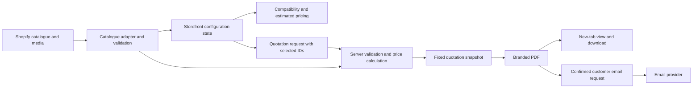

# Architecture and audit decisions

Status: Shopify page + React/TypeScript + Node backend selected as the planning baseline on 28 September 2026. This is not a completed Shopify audit, provisioned infrastructure or approval of live integration. See [IMPLEMENTATION_PLAN.md](IMPLEMENTATION_PLAN.md) for concrete technologies, repository layout, endpoint contracts and build tickets. Keep infrastructure proportionate to a single-store MVP and the agreed fee.

## Selected starting design

Use an isolated React/TypeScript component built with Vite inside a custom Shopify page/Liquid section, backed by Shopify Metaobjects/media and a Node/TypeScript quotation service on Vercel. Use CSS Modules, a Shopify app proxy, `@react-pdf/renderer` and a Resend adapter. Managed PostgreSQL holds quotation/dispatch state; private object storage holds generated PDF files. Confirm app ownership/authentication, store feasibility, storage provider, account/cost ownership and package versions during setup. Consider another integration only if actual store constraints justify changing this baseline.

Separate catalogue access, compatibility, money/VAT calculation, photo selection, state transitions, PDF generation and email delivery. Keep domain behaviour independent of Shopify/network access so it can be checked using fixtures. Use simple modules and clear types; introduce abstractions only where they isolate real boundaries.

Shopify app proxies can route storefront requests to an application, so they are a candidate for quotation endpoints. Verify the actual store/app permissions and response behaviour during the spike. Do not assume proxy requests provide normal cookie-based sessions: Shopify documents stripped Cookie/Set-Cookie headers. [Official app proxy documentation](https://shopify.dev/docs/apps/build/online-store/app-proxies), checked 28 September 2026.

Evaluate Metaobjects for structured catalogue records and Files/product media for assets; confirm ownership, editing permissions and storefront exposure for the chosen definitions. [Official metaobjects documentation](https://shopify.dev/docs/apps/build/metaobjects), checked 28 September 2026.

## Proposed data contract

All records have a stable ID and an explicit schema version. Client-editable records also include active status and display order. Keep example values out of production imports.

| Entity | Required information |
|---|---|
| LayoutPreset | ID, name, family, description, labelled fixed dimensions in mm, base price, currency, photos, compatible island/storage/carcass references |
| IslandOption | ID, name, description, labelled fixed dimensions, price, photos, secondary dimension image, compatible layouts; explicit no-island selection where allowed |
| StorageOption | ID, name, description, thumbnail/detail images, price, allowed combinations, selection group and group rules |
| CarcassOption | ID, name, description, named swatch, reference photo, price modifier, compatibility |
| CompatibilityRule | Supported IDs/conditions, allowed or excluded selection, message; constraints sufficient to express actual client rules |
| PhotoAsset | ID, Shopify/media reference, view type, alt text, role as exact/reference/dimension/detail, approval status |
| CombinationPhoto | Canonical selection key, final-combination photo reference, client verification status; storage IDs sorted for stable keys |
| PricingPolicy | Currency, base/addition rules, agreed extras if any, VAT treatment/rate, rounding rules, effective catalogue version |
| Configuration | Selected layout/island/storage/carcass IDs, current step, catalogue version; derive dimensions and price from the catalogue |
| QuotationSnapshot | Internal ID, catalogue version, resolved selections/names/dimensions, immutable price breakdown, currency/VAT, selected image and fallback label if used, issue/expiry dates, required notice, optional name, PDF reference |
| EmailDispatch | Quote/PDF reference, recipient supplied by customer, idempotency key, pending/accepted/failed status, provider reference and minimal diagnostic data |

Use an internal quotation ID for retries/operations; public share links, account saving and a customer configuration-code system are not part of this MVP. For money, choose integer minor units or a suitable decimal representation and explicit rounding. Never use unvalidated floating-point totals sent by a browser as the quotation price.

Avoid building a generic rules authoring platform. Implement the supplied compatibility needs using structured relationships/groups and add complexity only for confirmed rules.

## State and catalogue behaviour

1. Read and validate available catalogue data. A missing price, broken relationship or malformed dimension is a data error, not a free/default option.
2. On a selection change, recompute compatible downstream options and remove invalid selections. Explain what changed and require missing choices to be reselected.
3. Derive estimated price, dimensions, image selection and summary from the same state. Disable quotation for incomplete/invalid combinations.
4. If the server sees stale catalogue data, return updated selections/pricing information for customer review; do not silently issue a materially changed quote.
5. Keep selections during steps and service retries. If refresh recovery is approved, validate restored state against the current catalogue and exclude customer contact details from browser persistence by default.
6. Adding/disabling records or replacing assets must work through the chosen content interface; document refresh/cache behaviour and verify backend/frontend catalogue consistency.

## Photo resolution and launch coverage

- Resolve exact final-combination imagery from the canonical selection key.
- If exact imagery is missing or fails, use selected-layout imagery plus separate island/detail views where supplied, then approved generic references, then a placeholder.
- Show “Reference image — not the exact selected combination” on screen and in the PDF for fallback imagery. Preserve prices, selections and quotation controls.
- A quote must remain recoverable when an image cannot load; do not silently claim a fallback depicts the selected combination.
- Before launch, enumerate all valid final combinations, validate their exact-photo mappings, verify asset access and obtain client confirmation of image correctness. A fallback is operational recovery, never a substitute for launch coverage.
- Start with lazy loading, responsive assets and the Shopify CDN where applicable. Measure the preview before adding speculative optimization.

## Quotation and email contract

Proposed endpoint names below are internal placeholders, to be finalized after the integration decision.

| Operation | Input | Result and failure behaviour |
|---|---|---|
| Read catalogue | Public catalogue/version context | Safe public fields only; explicit failure/retry state |
| Create quotation | Selected IDs, catalogue version, request key | Validate IDs/compatibility, recalculate price, snapshot and generate PDF; return view/download reference or retryable error |
| View/download PDF | Unguessable scoped quote/PDF token | Open PDF without email collection; access/expiry policy chosen in audit |
| Email quotation | Quote reference, customer name/email, confirmation, request key | Validate recipient and confirmation, include supplied name, send corresponding PDF; expose accepted/failed status |

- On File Quotation, handle the user gesture/new-tab flow and provide a direct fallback open/download link. Test real Safari and popup-blocked behaviour.
- Snapshot price and content when the PDF is issued. Retries and email use that quote rather than recomputing from later catalogue changes.
- If a supplied name requires a personalized PDF, create an explicit associated version, retain its original commercial terms and make the personalized version viewable/downloadable before or with email confirmation. Confirm this UX with the client.
- Define whether re-filing an unchanged configuration reuses a quote or creates a new issue date. Use idempotency for repeated requests and double clicks.
- Store only what supports generation, retries and the agreed operational workflow. Choose PDF retention/link expiry, customer-data retention and expiry-date timezone in the audit. Do not assume a 90-day commercial validity automatically mandates 90-day server storage.
- Keep service credentials server-side, validate public request payloads, restrict asset retrieval to known catalogue media, escape PDF template text and apply suitable rate limits to generation/email.
- Use controlled email testing; never send client/customer messages merely to complete a test. Real test recipients and sending authorization must be established.
- Record provider acceptance separately from delivery or bounce events. No company copy, lead notification or marketing subscription.

## Required quotation content

Title: **Provisional Quotation**. Include final combination image, selected options, preset dimensions, price breakdown, VAT treatment, total excluding shipping, issue date, 90-day expiry and customer name when supplied.

Use this source notice verbatim on screen and PDF:

> This is a provisional quotation with a 90-day validity period from issue, subject to confirmation by Casen Doors staff. Shipping is not included at this stage and will be calculated on the final invoice. Please contact our staff for the final confirmed quotation and confirmation of its validity.

## Decisions to record during P1

| ID | Decision | Current state |
|---|---|---|
| D01 | Target store/theme, source repository, preview and isolated integration | Awaiting audit |
| D02 | Frontend stack and deployment/build process | React/TypeScript/Vite + CSS Modules selected for planning; theme bundle/deployment spike pending |
| D03 | Catalogue fields, editing roles, publication and refresh/cache behaviour | Awaiting Shopify audit and client data |
| D04 | Backend hosting, proxy/direct endpoint approach and secret ownership | Node/TypeScript on Vercel through app proxy planned; authentication/account ownership pending |
| D05 | PDF renderer, font/image support, delivery URLs and retention | React PDF + private object storage planned; prove deployed rendering/serving in week 1; retention pending |
| D06 | Email service, sender/domain setup, cost owner and authorized test recipient | Resend adapter planned; service/sender ownership and authorized test recipient pending |
| D07 | Currency, VAT, rounding, expiry timezone and repeat-issue behaviour | Awaiting client confirmation |
| D08 | Refresh recovery, analytics and storage-preview switching | Optional; unconfirmed |
| D09 | Catalogue size and exact-photo manifest including all storage/carcass combinations | Awaiting client inventory |
| D10 | Personalized PDF flow, service retention and operations handover | Proposed; confirm during audit |
| D11 | Durable quotation/dispatch persistence and file storage | Managed PostgreSQL + private object storage planned; provider, migrations, retention and costs pending |

## Evidence limits

The visual reference initially failed through the web reader, but was subsequently opened in the interactive browser on 28 September 2026. Its desktop appearance and visible controls were inspected; the prototype follows its warm neutral palette, serif heading and photo/option layout while preserving the source document's step order. Full visual fidelity and reference mobile behaviour have not been verified. [Primary visual reference](https://sig-kitchen-configurator.an225771202.chatgpt.site/).

At initial plan capture the workspace was empty. It now contains a working local React/Node/PDF fixture slice, tests and Shopify theme scaffolding. No store, app proxy, production credentials, hosting/storage or email integration has been verified. Current evidence and limitations are in [DEVELOPMENT.md](DEVELOPMENT.md) and the linked verification record.
